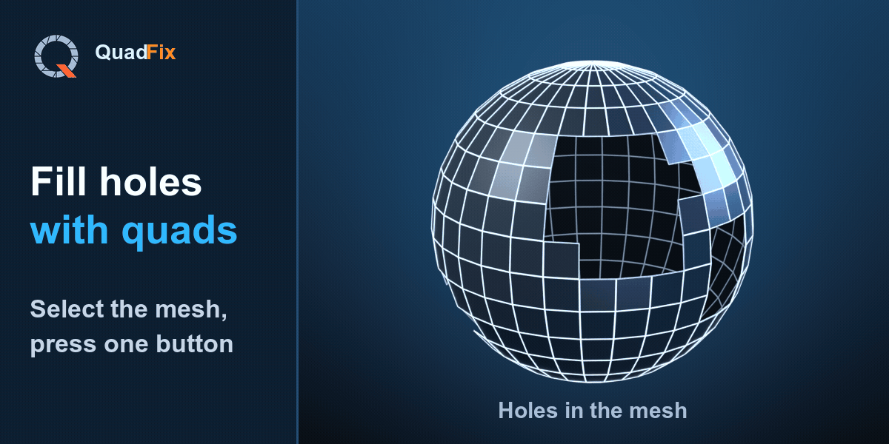
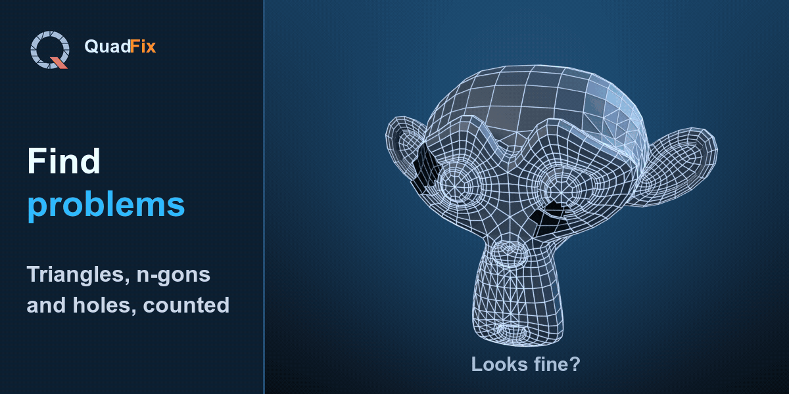
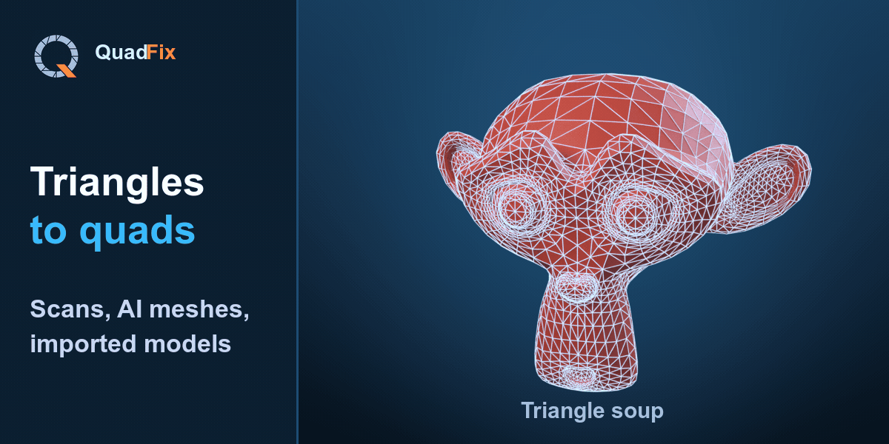
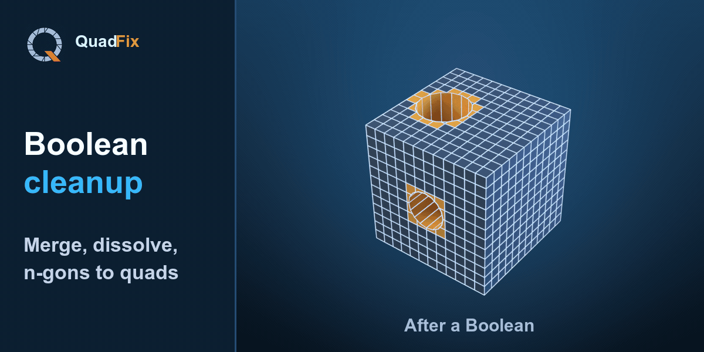
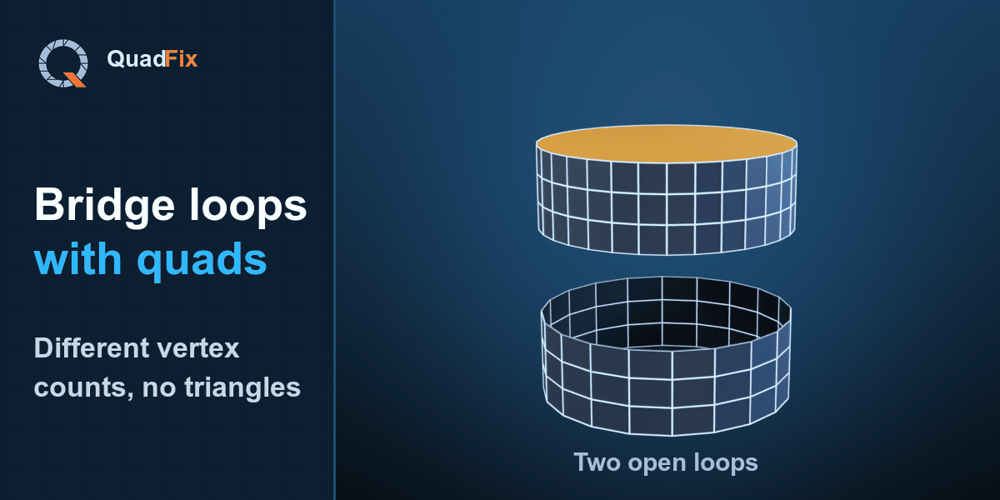
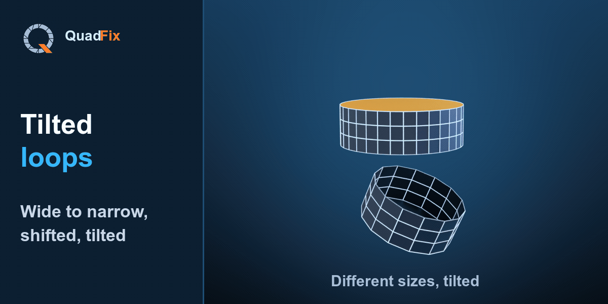
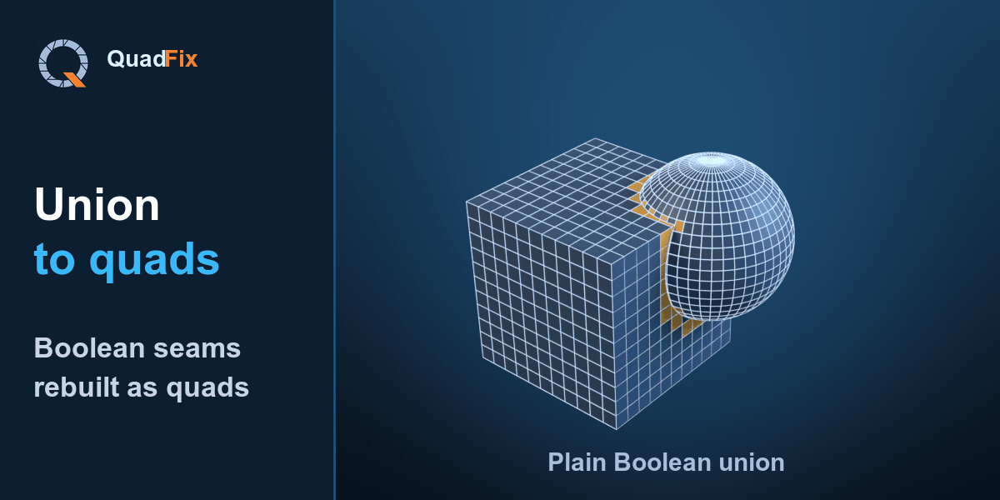

# QuadFix Lite — Blender add-on: n-gons to quads, tris to quads, boolean & import cleanup

Website: https://mendboxstudio.com/addons/quadfix · Full manual: https://mendboxstudio.com/docs/quadfix

**Full version — all 6 tools: Fill Holes with Quads, Bridge to Quads, Union to Quads, N-gons to Quads, Clean & Quad, Select Non-Quads & Holes → [Gumroad](https://mendbox.gumroad.com/l/quadfix) | [Superhive](https://superhivemarket.com/products/quadfix)**

Also on Blendkit (installs from inside Blender): [Lite](https://www.blendkit.com/asset-gallery-detail/6adfa8dd-92c5-42b8-8cbb-8956e045fd1d/) | [full version](https://www.blendkit.com/asset-gallery-detail/c6596556-7e49-4c4f-ba6f-7751f19bea54/)

QuadFix Lite is a free, open-source Blender add-on that converts triangles and n-gons to quads, cleans up meshes after Boolean cuts and imports (STL, OBJ, FBX, CAD, 3D scans, AI-generated meshes), and shows which faces are still not quads. Three buttons, no settings to learn, works on a selection or on the whole mesh. For Blender 4.2 LTS, 4.5 LTS and 5.x.

[Download the latest release](https://github.com/mendbox/quadfix-lite/releases/latest) · [Trailer of the full version on YouTube](https://youtu.be/h_6LSHC6sQY)

*Fill Holes with Quads (full version): holes closed with a clean quad grid, no triangle fan. [Get it on Gumroad](https://mendbox.gumroad.com/l/quadfix).*

## What Lite does

| Button | What it does |
|---|---|
| **N-gons to Quads** | Triangulates curved n-gons and joins triangles into quads. Flat n-gons (caps, CAD faces) are left alone by default, so clean flat surfaces stay clean. |
| **Clean & Quad** | One click after a Boolean or an import: merge doubles, remove degenerate and loose geometry, limited dissolve (keeps sharp edges and seams), tris to quads, recalculate normals. On a partial selection the unselected faces never change and the cleaned part keeps the normal direction of its neighbours. Clean grids and pole caps are left alone. |
| **Select Non-Quads & Holes** | Selects every triangle and n-gon and every open boundary edge, and prints the counts in the panel. |

## Lite vs Full

| Feature | Lite (free) | Full (paid) |
|---|:---:|:---:|
| Select Non-Quads & Holes | yes | yes |
| N-gons to Quads (convert triangles to quads) | yes | yes |
| Clean & Quad (boolean and import cleanup) | yes | yes |
| Only Selected / whole mesh, before/after report, undo | yes | yes |
| **Fill Holes with Quads** (quad grid instead of triangle fan) | no | yes |
| **Bridge to Quads** (loops with different vertex counts) | no | yes |
| **Union to Quads** (Boolean union, seam rebuilt as quads) | no | yes |

Lite stays free and complete for everything marked "yes". Get the full version on [Gumroad](https://mendbox.gumroad.com/l/quadfix) or [Superhive](https://superhivemarket.com/products/quadfix).

## Gallery (Lite features)

*Find problems: Select Non-Quads & Holes marks triangles, n-gons and open holes and counts them.*

*Triangles to quads on scans, AI meshes and imported models.*

*Boolean cleanup: merge, dissolve, n-gons to quads in one click.*

## Gallery (Full version only)

These need the full version, they are not in Lite.

*Fill Holes with Quads: select the mesh, press one button, holes close with a quad grid.*

*Bridge to Quads: loops with different vertex counts, joined with quads only.*

*Tilted, shifted loops, wide to narrow: the bridge strip stays all quads.*

*Union to Quads: Boolean seam rebuilt as a strip of quads.*

## Install (Blender 4.2 and newer)

1. Download the zip from the [Releases](https://github.com/mendbox/quadfix-lite/releases/latest) page. **Do not unzip it.**
2. In Blender open **Edit > Preferences > Get Extensions**, click the small arrow menu at the top right and choose **Install from Disk**, then pick the zip.
3. In the 3D viewport press `Tab` (Edit Mode), press `N` and open the **QuadFix Lite** tab.

## How to use

1. Select a mesh, `Tab` into Edit Mode, open the **QuadFix Lite** tab in the sidebar (`N`).
2. Press **Select Non-Quads & Holes** to see what needs work.
3. Select the faces you want to fix (or press `A`) and press **N-gons to Quads** or **Clean & Quad**.
4. Read the before/after counts at the bottom of the panel. `Ctrl+Z` (`Cmd+Z` on Mac) undoes any step in one go.

Untick **Only Selected** to process the whole visible mesh (hidden geometry is never touched). With Only Selected on, select whole faces: vertices and edges on the border of the selection are left as they are, so the faces next to it do not change.

Several objects in Edit Mode: **Clean & Quad** and **Select Non-Quads & Holes** work on all of them, **N-gons to Quads** works on the active object and says so in the report.

## When to use it

- After a Boolean cut leaves triangles, n-gons and loose bits around the cut.
- STL, OBJ, FBX and CAD imports (STEP, IGES exported as meshes) full of triangles and duplicate vertices.
- 3D scans and photogrammetry meshes where you want fewer triangles before sculpting or UV work.
- AI-generated meshes (Meshy, Tripo, Hunyuan3D and similar) that come in as triangle soup.
- Game assets that must be quads before UV unwrapping, subdivision or baking.
- 3D printing prep: Select Non-Quads & Holes shows open boundary edges (holes) before you export an STL.

## FAQ

### How do I fill holes with quads in Blender?
Blender's **Grid Fill** (Face > Grid Fill) works on one boundary loop with an even number of edges. For many holes or odd loops you have to fix them one by one. Lite does not fill holes. The full QuadFix adds **Fill Holes with Quads**, which closes holes with a quad grid and handles odd loops: [Gumroad](https://mendbox.gumroad.com/l/quadfix) | [Superhive](https://superhivemarket.com/products/quadfix).

### How do I convert triangles to quads in Blender?
Select the faces and use **Face > Tris to Quads** (`Alt+J`). It only joins pairs of neighbouring triangles whose angles are within *Max Face Angle* and *Max Shape Angle*, and options such as *Compare Seams / Sharp / UVs / Materials* block joins across those borders. QuadFix Lite's **N-gons to Quads** joins triangles with adjustable angles, and **Aggressive Quads** joins any two triangles regardless of angle when you want the fewest triangles.

### Why does Tris to Quads (Alt+J) not convert all my triangles?
See the answer above: the angle limits and the compare options decide which pairs may join, and it ignores n-gons. Triangles that have no neighbour to pair with also stay triangles.

### How do I convert n-gons to quads in Blender?
Select the n-gons, triangulate them (`Ctrl+T`) and run Tris to Quads (`Alt+J`). **N-gons to Quads** does both in one click and skips flat n-gons on purpose. Flat n-gons are harmless unless you plan to subdivide or deform the mesh.

### How do I clean up a mesh after a Boolean in Blender?
Merge by Distance, Limited Dissolve with a few degrees of angle, then Tris to Quads and recalculate normals (on a partial selection: keep the direction of the surrounding faces). **Clean & Quad** runs that sequence, keeps sharp edges and seams, and reports vertex, quad, triangle and n-gon counts before and after.

### How do I fix an AI-generated mesh (Meshy, Tripo, Hunyuan3D) in Blender?
AI meshes usually arrive as dense triangle soup with duplicate vertices. Run **Select Non-Quads & Holes** to see the state, then **Clean & Quad**, then **N-gons to Quads** (turn **Keep Planar N-gons** off and try **Aggressive Quads** for scans). This repairs the mesh you have, it does not rebuild edge flow.

### How do I find n-gons and triangles in Blender?
**Select > Select All by Trait > Faces by Sides** finds faces with more than 4 vertices. **Select Non-Quads & Holes** finds all triangles and n-gons and the open boundary edges in one click.

### Is it a retopology tool or a remesher?
No. It repairs the mesh you have and does not rebuild edge flow. On dense scans some triangles will remain. For automatic retopology use a remesher such as Quad Remesher, QRemeshify or Blender's own Quadriflow.

### Does it work with Blender 5.x?
Yes. The test suite (38 checks on Boolean, scan, AI-like and attributed meshes, with vertex, edge and face select modes, partial selections and undo) passes on Blender 4.2.23, 4.5.14 and 5.2.2, on macOS, Windows 11 and Linux. The suite also checks that UV maps, vertex groups and colour attributes are still there afterwards.

### Does it phone home or need extra libraries?
No. Pure Python with Blender's own `bmesh`, no internet access, no dependencies.

## Options

| Option | Default | Meaning |
|---|---|---|
| Only Selected | on | Work on the selected faces only (off = the whole visible mesh) |
| Face Angle | 90 deg | Max angle between two triangle normals to join them |
| Shape Angle | 90 deg | Max deviation from a rectangle to accept a quad |
| Keep Planar N-gons | on | Leave flat n-gons untouched, convert only curved ones and triangles |
| Aggressive Quads | off | Join any two triangles into a quad, fewest triangles, less regular shapes |
| Merge Distance | 0.0001 | Merge vertices closer than this (Clean & Quad) |
| Dissolve Angle | 5 deg | Limited dissolve angle (Clean & Quad) |
| Keep Sharp Edges | on | Do not dissolve edges marked sharp or seam |

## Limitations

- Not a remesher and not an automatic retopology tool.
- Lite does not fill holes, bridge loops or union meshes (see Lite vs Full above).
- Very irregular meshes and dense scans keep some triangles. Try **Aggressive Quads** if you prefer fewer triangles over regular shapes.
- Works on Windows, macOS and Linux (Blender 4.2 LTS and newer). Tested on macOS, Windows 11 (x86-64) and Linux (x86-64).

## Development

`tests/run_all_versions.sh` runs the assertion suite on every Blender found in `/Applications` and `~/Applications/blender-versions`. Bug reports and pull requests are welcome, please attach a small `.blend` that shows the problem.

## License

GPL-3.0-or-later, see [LICENSE](LICENSE). Support: support@mendboxstudio.com

---
*Keywords: Blender add-on, Blender extension, tris to quads, n-gons to quads, convert triangles to quads, fill holes with quads, clean up mesh after boolean, select non-quads, mesh cleanup, STL import cleanup, 3D scan cleanup, AI generated mesh cleanup, Meshy, Tripo, Hunyuan3D.*
